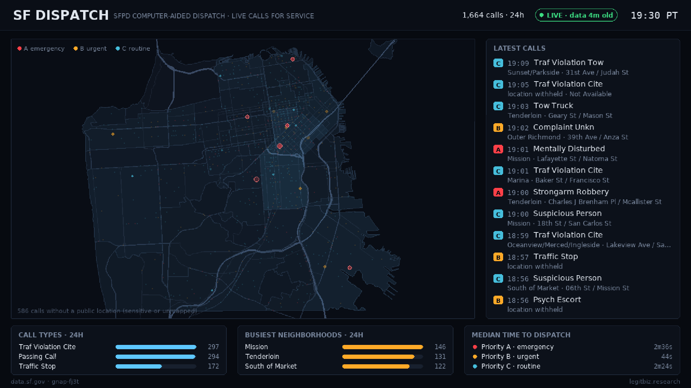

# pizero-tv

**A $15 computer pretending to be a mission control center, and getting away with it.**

pizero-tv turns a Raspberry Pi Zero 2 W and whatever TV you've stopped watching into an
ambient intelligence wall. Live data, full screen, no remote required. Guests will ask
what you do for a living. Say "research." Leave it there.



---

## The one rule

**Everything on screen is real, or it says it isn't.**

This project has history. An earlier generation of these screens was written by a
different AI with a vivid imagination. It tracked a flight from Chicago that never took
off. It ran a LAN radar that found a PlayStation 5 nobody owned. Its headlines were
written by nobody, about nothing, with 482 upvotes. It looked incredible and believed
nothing.

So here, when the data goes away, the screen says **OFFLINE** in red, out loud. It does
not quietly swap in a confident-looking number. A dashboard that lies is worse than a
blank wall, because a blank wall at least has the decency to look like a wall.

---

## Modules

| Module | What it shows | Status |
|---|---|---|
| `sfdispatch` | Live SFPD calls for service on a San Francisco street map: priority, neighborhood, time to dispatch. | ✅ Shipped. Honest. |
| everything else | Being rebuilt from the ground up with real data, real fonts and fewer feelings. | 🚧 Under (re)construction |

### sfdispatch

San Francisco publishes its police dispatch log as open data, which is either a triumph
of civic transparency or a very specific screensaver. We chose both.

- **~1,700 calls a day.** Pins drop onto the map as calls come in, ripple on arrival and
  fade over an hour. Priority A calls pulse red, because emergencies should be visible
  from the couch.
- **Replayed, not dumped.** The city updates the feed every ~10 minutes. Instead of
  blinking 15 pins into existence and then sulking, each batch is replayed in the order
  the calls happened, so the map stays alive.
- **Late calls aren't lost.** A call only shows up in the feed once it's been dispatched.
  The slow ones would quietly go missing and make the response-time stats look
  heroic, so every 10 minutes the module re-reads the full 24 hours. Flattering
  statistics are a bug.
- **Sensitive calls stay sensitive.** Calls the city withholds a location for are counted,
  never plotted. "Passing Call" (an officer driving by) is counted and mapped but kept out
  of the side list, where it was crowding out everything interesting.
- **No key, no account, no SDR.** If you came here hoping to use a radio, see *Roadmap*,
  and also see local encryption laws, and also see a therapist.

---

## Hardware

- Raspberry Pi Zero 2 W (four cores, 512 MB of RAM, zero complaints)
- A TV with HDMI
- The willingness to explain to visitors that no, you are not a dispatcher

It runs on Raspberry Pi OS (Debian trixie) under the labwc Wayland compositor, with pygame
drawing at 1280×720 and scaling up to 1080p. On the Zero, `sfdispatch` uses about 30% of
one core and about 46 MB of RAM, because it draws the parts that don't change once and
only animates the parts that do. The first draft redrew everything on every frame and
used 100% of a core. We don't talk about the first draft.

---

## Quick start

```bash
# on your dev machine
git clone https://github.com/NPCmillionaire/pizero-tv && cd pizero-tv
uv venv --python 3.13 .venv
uv pip install pytest pygame==2.6.1 requests
.venv/bin/python -m pytest -q                     # 41 tests, all green, all real

# try it locally in a window
SFD_WINDOWED=1 .venv/bin/python modules/sfdispatch/sfdispatch.py

# ship it to the Pi
./deploy.sh pizero sfdispatch                     # ./deploy.sh <host> <module>
ssh pizero 'tv sfdispatch'                        # once it's registered in the tv controller (see below)
```

`deploy.sh` copies the module to `~/tv/modules/<module>/` on the Pi. The `tv` controller
there launches modules, kills the previous one, and keeps only one on screen at a time,
because 512 MB of RAM is a lot of things, but it is not two things. `tv` isn't in this repo
yet (that's the first roadmap item), so on a fresh Pi you'll have to add the module to it yourself.

Keys, if a keyboard is plugged in: **Space** highlights the next call, and **Q** or **Esc**
quits. There is no key for "make it stop being interesting."

---

## Layout

```
modules/sfdispatch/
  sfdispatch.py   # the screen: pygame, fetch thread, animation
  feed.py         # SFPD feed: fetch, parse, dedupe, 24 h window, stats
  replay.py       # spreads each batch over time so pins keep dropping
  geo.py          # lon/lat → pixels; also where San Francisco ends
  ui.py           # fonts, colors, and fit(), the function that ends text overflow
  basemap.json    # pre-built streets + neighborhoods (the Pi never calls Overpass)
  fonts/          # DejaVu, bundled, so no glyph ever renders as a sad little box
tools/
  build_sf_basemap.py   # rebuilds basemap.json from OpenStreetMap
deploy.sh
```

---

## Roadmap

- **Foundation.** One shared look for every module, modules discovered automatically
  instead of listed by hand, `tv -H <host>` to drive any Pi on the network by name, and a
  splash screen between modules so the TV never flashes the desktop at your guests.
- **The great rebuild.** The original twelve modules (markets, weather, space, flights
  and friends), remade with data that exists.
- **New screens.** Wi-Fi spectrum from a monitor-mode radio, a certificate-transparency
  phishing feed, CISA's list of vulnerabilities being exploited right now, satellites
  overhead, live Wikipedia edits, and a terminal mirror for typing at your TV like a
  movie hacker.

---

## Data

`sfdispatch` uses the City and County of San Francisco's *Law Enforcement Dispatched Calls
for Service: Real-Time* dataset (data.sf.gov, `gnap-fj3t`). Street geometry is © OpenStreetMap
contributors, under the ODbL. Neighborhood boundaries are SF Analysis Neighborhoods
(data.sf.gov). This is a hobby display, not an emergency service. If something on the
map concerns you, the number is 911, not a GitHub issue.

---

<p align="center"><sub>legitbiz.research · nothing on this screen is made up</sub></p>
