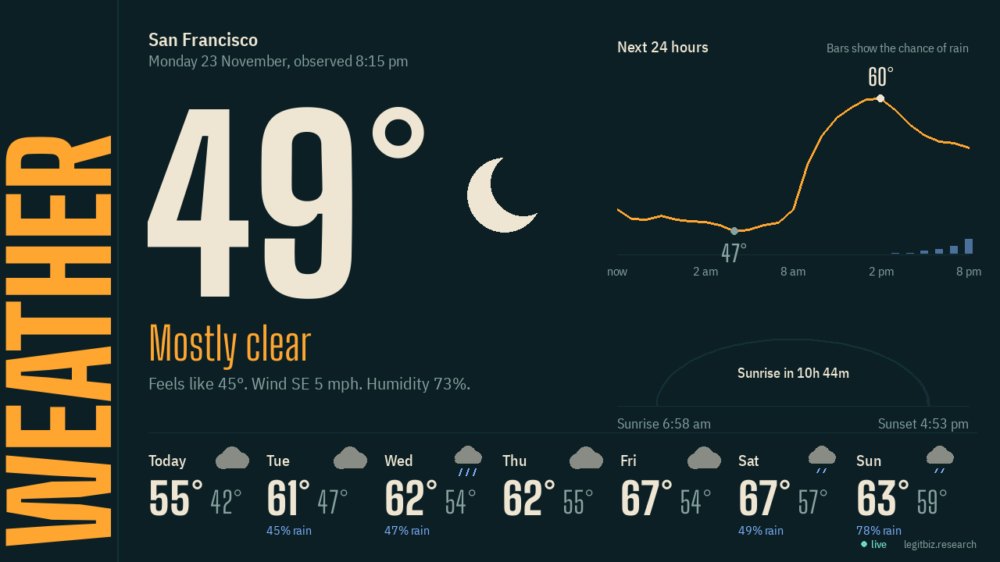
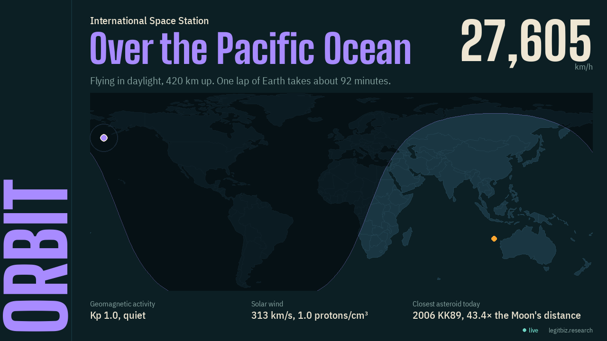
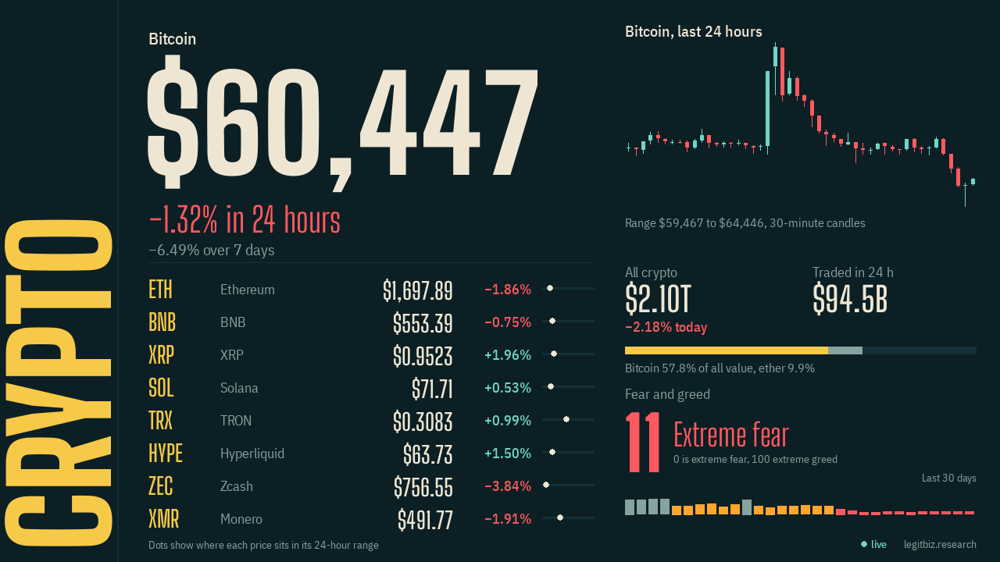

# pizero-tv

**A $15 computer pretending to be a mission control center, and getting away with it.**

pizero-tv turns a Raspberry Pi Zero 2 W and whatever TV you've stopped watching into an
ambient intelligence wall: sixteen channels of live data, video and generative art, flipped like an old TV
and controlled from any terminal on your network.
Guests will ask what you do for a living. Say "research." Leave it there.


---

## The one rule

**Everything on screen is real, or it says it isn't.**

This project has history. An earlier generation of these screens was written by a
different AI with a vivid imagination. It tracked a flight from Chicago that never took
off. It ran a LAN radar that found a PlayStation 5 nobody owned. Its headlines were
written by nobody, about nothing, with 482 upvotes. Its "cyber war room" counted 4,808
attacks a second, every second, forever. It looked incredible and believed nothing.

So here, when a source goes quiet, the footer says **stale 12m** or **offline** and the
screen says what it's waiting for. It never swaps in a confident-looking number. A
dashboard that lies is worse than a blank wall, because a blank wall at least has the
decency to look like a wall.

---

## The screens

| Spine | Module | What's on it | Where it comes from |
|---|---|---|---|
| WEATHER | `weather` | Temperature, the next 24 hours, where the sun is, the week | Open-Meteo |
| MARKETS | `finance` | S&P 500, Nasdaq, Dow, Russell, a rotating spotlight stock, sectors, VIX, yields, gold, oil | Yahoo Finance |
| CRYPTO | `crypto` | Bitcoin up close, the top coins (no stablecoins), market totals, fear and greed | CoinGecko, alternative.me |
| THREATS | `threatmap` | The internet's threat level, most probed ports, where today's busiest attackers are | SANS Internet Storm Center, ip-api, abuse.ch |
| AIRSPACE | `flights` | Every aircraft broadcasting within 60 nautical miles, on a radar scope | adsb.lol |
| ORBIT | `space` | The ISS and its ground track, the real day/night line, space weather, the closest asteroid | wheretheiss.at, NOAA SWPC, NASA |
| SIGNAL | `news` | Earthquakes worldwide and the Hacker News front page | USGS, Hacker News |
| DISPATCH | `sfdispatch` | San Francisco police calls for service, on a street map | DataSF |
| SYSTEM | `syshud` | The Pi itself: cores, memory, temperature, throttling, network | psutil, vcgencmd |
| LAN | `lanradar` | Every device on your network, with newcomers flagged | your kernel's neighbor table, a ping sweep |
| MATRIX | `matrix` | Digital rain in real katakana | art |
| OUTRUN | `retro` | A synthwave road, the Game of Life, a nixie-tube clock | art |
| TRIPPY | `trippy` | Generative color fields | art (and numpy) |
| COMPUTERPHILE | `computerphile` | Computerphile videos, picked at random, back to back | YouTube via yt-dlp and mpv |
| SHORTS | `shorts` | Science and engineering Shorts | YouTube via yt-dlp and mpv |
| GUIDE | `guide` | Channel 00: what's on every channel | the channels themselves |

<table>
<tr><td></td><td></td></tr>
<tr><td></td><td></td></tr>
<tr><td></td><td></td></tr>
<tr><td></td><td></td></tr>
</table>

---

## Flipping channels

Every screen is a numbered channel, with the guide on 00. Changing channel gives you
0.4 seconds of honest analog snow and then the new channel, with a green `CH 04  MARKETS`
in the corner for three seconds, the way TVs used to. `tv up`, `tv down` and `tv 7` work
like a remote, and so do the arrow and number keys on a plugged-in keyboard (two digits
within a second make one channel number).

## Video channels

COMPUTERPHILE and SHORTS play YouTube full screen through mpv, using hardware video
decoding, at up to 720p. The remote keeps working while a video plays. They need two things on the Pi:

```bash
sudo apt install -y mpv
mkdir -p ~/.local/bin && curl -L -o ~/.local/bin/yt-dlp \
  https://github.com/yt-dlp/yt-dlp/releases/latest/download/yt-dlp && chmod +x ~/.local/bin/yt-dlp
```

Debian's packaged yt-dlp lags YouTube's changes, hence the standalone copy (run
`~/.local/bin/yt-dlp -U` now and then). Add your own channels in `config.toml`:

```toml
[[video]]
name = "numberphile"
title = "NUMBERPHILE"
url = "https://www.youtube.com/@numberphile/videos"

[shorts]
channels = ["@veritasium", "@SmarterEveryDay"]
```

## The look

Each screen's name runs up the left edge in enormous condensed type, the **spine**, so
you know what you're looking at from across the room. Everything else stays quiet: deep
petrol background, bone-white numbers, one accent color per screen, no boxes around
everything, no drop shadows, no emoji, and no text allowed to spill out of its space
(there's a test for that). Type is Big Shoulders Display and IBM Plex, bundled.

`legitbiz.research` sits in the corner of every channel like a network bug.

---

## Hardware

- Raspberry Pi Zero 2 W (four cores, 512 MB of RAM, zero complaints)
- A TV with HDMI
- The willingness to explain to visitors that no, you are not an air traffic controller

It runs on Raspberry Pi OS (Debian trixie) in the default labwc Wayland session. One
long-running display host owns the screen and loads one screen at a time, drawing the
parts that don't change once and animating only the parts that do. That's how a computer
the size of a stick of gum keeps up with all of it.

---

## Install

```bash
git clone https://github.com/NPCmillionaire/pizero-tv && cd pizero-tv
./deploy.sh pizero              # any ssh host name; installs to ~/pizero-tv and autostarts
```

Then tell it where it lives. On the Pi, edit `~/.config/pizero-tv/config.toml` (the
deploy copies [`config.example.toml`](config.example.toml) there the first time). Your
location stays on the Pi and never goes anywhere near git.

```toml
[place]                 # weather and airspace
name = "San Francisco"
lat = 37.7749
lon = -122.4194

[lan]                   # the LAN sonar's ping sweep
subnet = "192.168.1.0/24"
```

## Drive it

```bash
tv                       # what's on screen
tv weather               # tune by name (tv list shows channels and aliases)
tv 4                     # tune by number; tv up / tv down to flip
tv next                  # skip ahead
tv cycle 90              # rotate through everything, 90 s each (the default)
tv cycle 60 weather crypto threats
tv stop                  # standby clock
tv screenshot tv.png     # save exactly what the TV shows
tv -H pizero crypto      # any of the above, on another Pi, over ssh
```

With a keyboard plugged in, **Space** advances whatever a screen rotates through
(spotlight stock, highlighted call, retro mode, trippy field).

---

## Make a screen

A screen is a folder in `modules/` with an `__init__.py` that exports `MODULE`. The host
finds it on its own.

```python
from tvkit import text, theme
from tvkit.module import Module


class Tides(Module):
    name, title, key = "tides", "TIDES", theme.SEAGLASS
    blurb = "High and low water"

    def start(self, ctx):
        super().start(ctx)
        self.src = self.source("tides", fetch_tides, interval=900, parse=parse_tides)

    def draw_static(self, surf):           # redrawn only when data changes
        if self.src.value:
            text.draw(surf, self.src.value.next_high, (190, 60), "display", 160)

MODULE = Tides
```

`self.source()` polls on its own thread, caches the last good payload to disk, and
reports `waiting`, `live`, `stale` or `offline`, which the footer shows. `draw_live()`
is for anything that moves. The shared render test draws every screen in every one of
those states and fails if any text leaves the screen.

## Develop

```bash
uv venv --python 3.13 .venv
uv pip install pytest pygame==2.6.1 requests numpy psutil fonttools yt-dlp
.venv/bin/python -m pytest -q                         # 393 tests
TV_WINDOWED=1 .venv/bin/python -m tvkit --only crypto  # one screen in a window
```

```
bin/tv           the CLI (local socket, or ssh with -H)
tvkit/           host, splash, Module API, Source, theme, text, charts, world map, fonts
modules/         one folder per screen
tools/           rebuild fonts, world map, SF basemap, MAC vendor table, test fixtures
deploy.sh        install or update a Pi
```

---

## Credits and data

Weather: [Open-Meteo](https://open-meteo.com). Markets: Yahoo Finance (unofficial).
Crypto: [CoinGecko](https://www.coingecko.com), [alternative.me](https://alternative.me/crypto/fear-and-greed-index/).
Threats: [SANS Internet Storm Center](https://isc.sans.edu), [ip-api](https://ip-api.com),
[abuse.ch Feodo Tracker](https://feodotracker.abuse.ch). Aircraft: [adsb.lol](https://adsb.lol) (ODbL).
Orbit: [wheretheiss.at](https://wheretheiss.at), [NOAA SWPC](https://www.swpc.noaa.gov),
[NASA NeoWs](https://api.nasa.gov). Signal: [USGS](https://earthquake.usgs.gov), [Hacker News](https://news.ycombinator.com).
Dispatch: [DataSF](https://data.sfgov.org) `gnap-fj3t`; streets © OpenStreetMap contributors (ODbL).
World map: [Natural Earth](https://www.naturalearthdata.com) (public domain). MAC vendors: IEEE registry.
Fonts: Big Shoulders Display and IBM Plex (SIL OFL), a katakana subset of Droid Sans Fallback (Apache 2.0);
licenses in `tvkit/fonts/`.

This is a hobby display, not an emergency service. If something on the dispatch map
concerns you, the number is 911, not a GitHub issue.

<p align="center"><sub>legitbiz.research · nothing on this screen is made up</sub></p>
