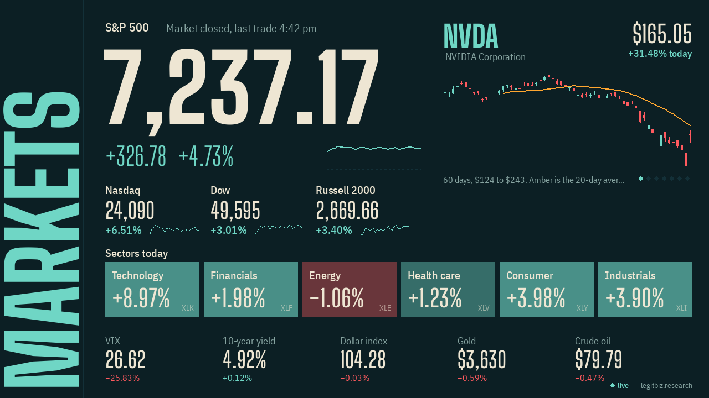
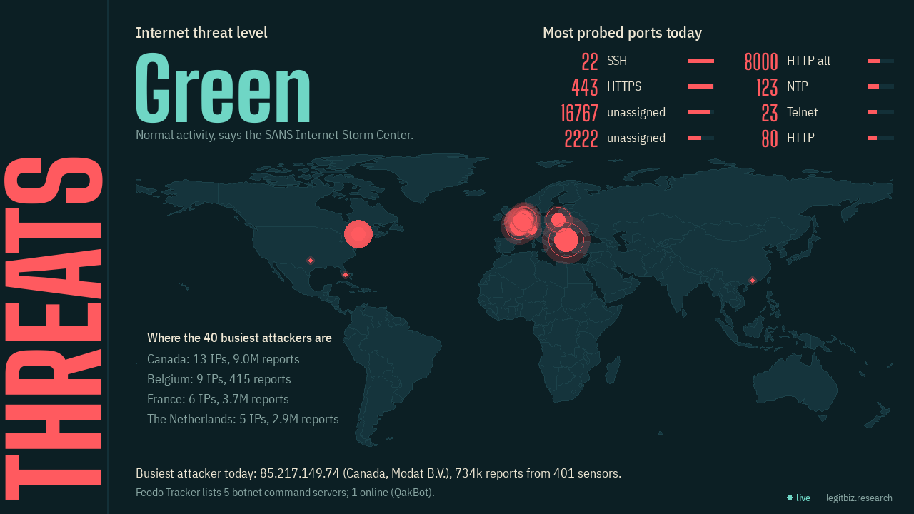
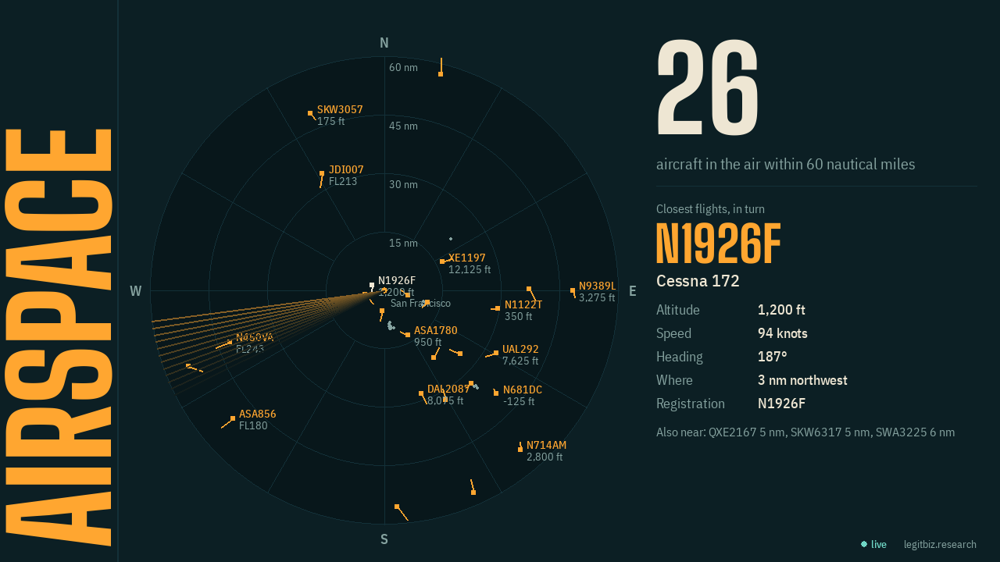
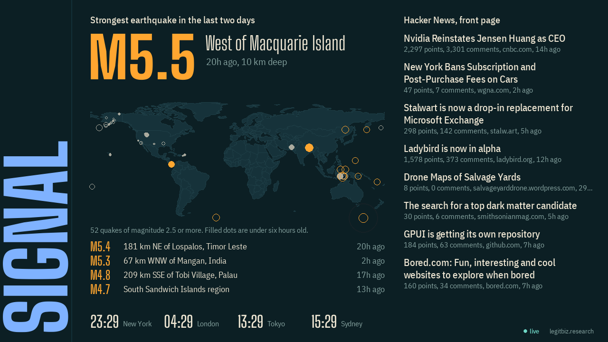
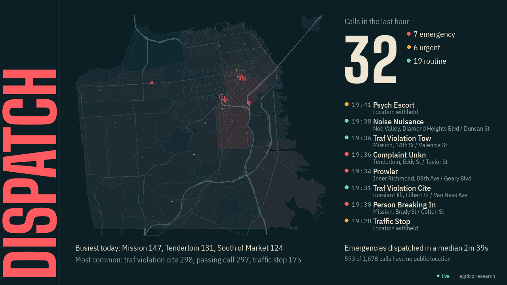
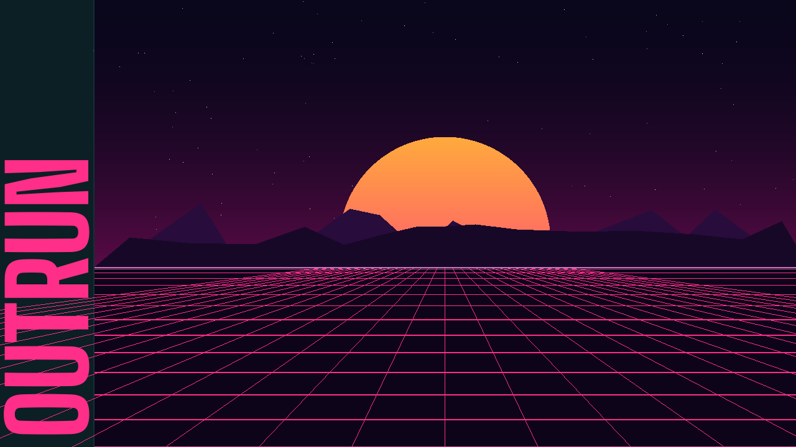

# pizero-tv

**A $15 computer pretending to be a mission control center, and getting away with it.**

pizero-tv turns a Raspberry Pi Zero 2 W and whatever TV you've stopped watching into an
ambient intelligence wall: two dozen channels of live data, video and generative art, flipped like an old TV
and controlled from any terminal on your network. Every channel is its own station, with its own look.
Guests will ask what you do for a living. Say "research." Leave it there.



---

## The one rule

**Everything on screen is real, or it says it isn't.**

This project has history. An earlier generation of these screens was written by a
different AI with a vivid imagination. It tracked a flight from Chicago that never took
off. It ran a LAN radar that found a PlayStation 5 nobody owned. Its headlines were
written by nobody, about nothing, with 482 upvotes. Its "cyber war room" counted 4,808
attacks a second, every second, forever. It looked incredible and believed nothing.

So here, when a source goes quiet, the footer says **stale 12m** or **offline** and the
screen says what it's waiting for. It never swaps in a confident-looking number. A
dashboard that lies is worse than a blank wall, because a blank wall at least has the
decency to look like a wall.

---

## The screens

| Ch | Channel | Looks like | What's on it | Where it comes from |
|---|---|---|---|---|
| 00 | GUIDE | The cable listings channel | What's on every channel, scrolling past | the channels themselves |
| 01 | WEATHER | A local-forecast cable station | Conditions, the next 24 hours, the week, in pages, with a crawl | Open-Meteo |
| 02 | MARKETS | A business-news desk | S&P 500 intraday, a spotlight stock, sectors, a two-line ticker | Yahoo Finance |
| 03 | CRYPTO | A late-night neon trading show | Bitcoin, the board, a fear-and-greed dial | CoinGecko, alternative.me |
| 04 | THREATS | An amber war-room CRT | The internet's threat level, most probed ports, where attackers are | SANS Internet Storm Center, ip-api, abuse.ch |
| 05 | WANTED | Wanted posters on a corkboard | Vulnerabilities attackers are exploiting right now, newest first | CISA Known Exploited Vulnerabilities |
| 06 | AIRSPACE | An approach-control scope | Aircraft within 60 nm, with paper flight strips | adsb.lol |
| 07 | REGISTRY | A detective's case file | Who owns the planes overhead: owner, city, make, year | FAA registry (via govint-data) |
| 08 | ORBIT | Mission control | The ISS, day and night on Earth, space weather | wheretheiss.at, NOAA SWPC, NASA |
| 09 | SIGNAL | A breaking-news bulletin | Earthquakes worldwide, world clocks, the Hacker News front page | USGS, Hacker News |
| 10 | DISPATCH | A police dispatch terminal | San Francisco police calls on a street map | DataSF |
| 11 | SYSTEM | A BIOS setup screen | The Pi, plus any other machine you point it at | psutil, the stats agent |
| 12 | MINER | A power-plant control panel | An XMRig rig's hashrate, shares and what the pool owes you | XMRig's API, MoneroOcean, CoinGecko |
| 13 | LAN | Submarine sonar | Every device on your network, newcomers flagged | your neighbor table, a ping sweep |
| 14 | TERMINAL | Public-access cable | Your shell, live, from `tv mirror` (tunes in by itself) | you |
| 15–16 | COMPUTERPHILE, SHORTS | Color bars, then the video | YouTube, full screen, with captions | yt-dlp and mpv |
| 17–19 | MATRIX, OUTRUN, TRIPPY | Themselves | Digital rain, a synthwave road, generative color | art |
| 20–23 | LIQUID, MANDALA, FRACTAL, DREAM | A 1967 light show, sacred geometry, a morphing Julia set, video feedback | Full-screen psychedelia | art (and numpy) |

Channel numbers follow the order on your Pi (`tv list` shows them), so yours may differ if you add channels.

<table>
<tr><td></td><td></td></tr>
<tr><td></td><td></td></tr>
<tr><td></td><td></td></tr>
<tr><td></td><td></td></tr>
</table>

---

## Flipping channels

Every screen is a numbered channel, with the guide on 00. Changing channel gives you
0.4 seconds of honest analog snow and then the new channel, with a green `CH 04  MARKETS`
in the corner for three seconds, the way TVs used to. `tv up`, `tv down` and `tv 7` work
like a remote, and so do the arrow and number keys on a plugged-in keyboard (two digits
within a second make one channel number).

## Video channels

COMPUTERPHILE and SHORTS play YouTube full screen through mpv, using hardware video
decoding, at up to 720p. The remote keeps working while a video plays. They need two things on the Pi:

```bash
sudo apt install -y mpv
mkdir -p ~/.local/bin && curl -L -o ~/.local/bin/yt-dlp \
  https://github.com/yt-dlp/yt-dlp/releases/latest/download/yt-dlp && chmod +x ~/.local/bin/yt-dlp
```

Debian's packaged yt-dlp lags YouTube's changes, hence the standalone copy (run
`~/.local/bin/yt-dlp -U` now and then). Add your own channels in `config.toml`:

```toml
[[video]]
name = "numberphile"
title = "NUMBERPHILE"
url = "https://www.youtube.com/@numberphile/videos"

[shorts]
channels = ["@veritasium", "@SmarterEveryDay"]
```

## The look

Every channel is a different kind of station, the way flipping through cable used to feel:
the forecast is on a beveled blue panel with a yellow crawl, the markets have a ticker, the
threat level is a lit lamp on an amber CRT, aircraft get paper flight strips, the Pi's own
health is a BIOS screen. Each has its own palette and typeface (Jost, Bungee, Saira Stencil,
B612 Mono, Oxanium, Anton, VT323, Share Tech Mono, Barlow Condensed, Big Shoulders and IBM
Plex, all bundled). What stays the same everywhere is the TV around them: the snow between
channels, the green channel number, and `legitbiz.research` in the corner like a network bug.

And everywhere, no text is allowed to spill out of its space or draw a missing-glyph box;
the tests render every channel in every data state and fail if it does.

---

## Hardware

- Raspberry Pi Zero 2 W (four cores, 512 MB of RAM, zero complaints)
- A TV with HDMI
- The willingness to explain to visitors that no, you are not an air traffic controller

It runs on Raspberry Pi OS (Debian trixie) in the default labwc Wayland session. One
long-running display host owns the screen and loads one screen at a time, drawing the
parts that don't change once and animating only the parts that do. That's how a computer
the size of a stick of gum keeps up with all of it.

---

## Install

```bash
git clone https://github.com/NPCmillionaire/pizero-tv && cd pizero-tv
./deploy.sh pizero              # any ssh host name; installs to ~/pizero-tv as a systemd user service
```

Then tell it where it lives. On the Pi, edit `~/.config/pizero-tv/config.toml` (the
deploy copies [`config.example.toml`](config.example.toml) there the first time). Your
location stays on the Pi and never goes anywhere near git.

```toml
[place]                 # weather and airspace
name = "San Francisco"
lat = 37.7749
lon = -122.4194

[lan]                   # the LAN sonar's ping sweep
subnet = "192.168.1.0/24"
```

The display host runs as a systemd user service (`pizero-tv.service`), not from your
login or an ssh session, so a dropped ssh connection can't take the TV down, and if the
host ever crashes it's back in three seconds. `systemctl --user status pizero-tv` and
`tv logs` tell you what it's doing.

### Other machines on the SYSTEM channel

SYSTEM shows the Pi, and any other Mac or Linux box running the stats agent: a small,
standard-library-only script that answers read-only stats on port 8765, to private network
addresses only.

```bash
./tools/install_agent.sh          # this Mac (launchd) or this Linux box (systemd)
./tools/install_agent.sh arch     # a Linux machine over ssh
```

Then list them in the Pi's `config.toml`:

```toml
[[system.hosts]]
name = "darwin"
url = "http://darwin.local:8765"
```

### MINER

Point it at an XMRig rig with the HTTP API turned on (`"http": {"enabled": true,
"restricted": true, "access-token": "..."}`, port published on your LAN), and give it your
pool wallet for the payout side (MoneroOcean's public API):

```toml
[miner]
url = "http://arch.lan:8081"
token = "the rig's access-token"
wallet = "4..."
```

### TERMINAL

```bash
tv mirror -H pizero       # this terminal goes on the TV until you exit the shell
```

Your shell keeps working as normal; everything it prints is also streamed to the Pi, which
tunes to TERMINAL while you're connected and goes back to what was on when you exit.
Nothing is recorded. The Pi needs `sudo apt install python3-pyte` for this one.

## Drive it

```bash
tv                       # what's on screen
tv weather               # tune by name (tv list shows channels and aliases)
tv 4                     # tune by number; tv up / tv down to flip
tv next                  # skip ahead
tv cycle 90              # rotate through everything, 90 s each (the default)
tv cycle 60 weather crypto threats
tv stop                  # standby clock
tv screenshot tv.png     # save exactly what the TV shows
tv -H pizero crypto      # any of the above, on another Pi, over ssh
```

With a keyboard plugged in, **Space** advances whatever a screen rotates through
(spotlight stock, highlighted call, retro mode, trippy field).

---

## Make your own channel

There are two ways, depending on whether you want to write code.

### A YouTube channel, no code

Add a `[[video]]` block to `~/.config/pizero-tv/config.toml` on the Pi and restart the
host (`pkill -f "python3 -m tvkit"`; it comes straight back). The new channel gets the
next free number and shows up in the guide.

```toml
[[video]]
name = "numberphile"                 # what you type: tv numberphile
title = "NUMBERPHILE"                # the spine and the on-screen display
url = "https://www.youtube.com/@numberphile/videos"
blurb = "Videos about numbers"       # optional, shown in the guide

[shorts]                             # replaces the SHORTS channel's sources
channels = ["@veritasium", "@SmarterEveryDay", "@minutephysics"]
```

Any YouTube channel's `/videos`, `/shorts` or a playlist URL works.

### A data channel, in Python

A channel is a folder in `modules/` whose `__init__.py` exports `MODULE`. The host finds it
on its own. Here's a complete one that shows the current Bitcoin block height:

```python
# modules/blocks/__init__.py
import requests

from tvkit import text, theme
from tvkit.module import Module


def fetch():                                   # runs on a background thread
    return requests.get("https://mempool.space/api/blocks/tip/height", timeout=15).json()


class Blocks(Module):
    name, title, key = "blocks", "BLOCKS", theme.SODIUM   # tv blocks, spine text, accent color
    blurb = "The newest Bitcoin block"                     # one line for the guide
    order = 35                                             # channel number comes from this

    def start(self, ctx):
        super().start(ctx)
        self.height = self.source("height", fetch, interval=60, parse=int)

    def draw_static(self, surf):                           # redrawn only when the data changes
        if self.height.value is None:
            text.draw(surf, "Waiting for mempool.space", (190, 300), "sans", 24, theme.LICHEN)
            return
        text.draw(surf, "Latest block", (190, 40), "sans-500", 22, theme.BONE)
        text.draw(surf, f"{self.height.value:,}", (186, 70), "display", 220, theme.BONE)


MODULE = Blocks
```

What you get for free:

- **`self.source()`** polls on its own thread, caches the last good payload to disk,
  and never lets an exception reach your drawing code. Its `.status` is `waiting`,
  `live`, `stale` or `offline`, and the footer shows the worst one for you.
- **The frame.** By default you get the house look: the spine down the left, content
  between x 190 and 1250 on a 1280×720 canvas. Override `draw_frame(surf)` to build your
  own station instead; `tvkit.fx` has gradients, ticker crawls, scanlines and neon glow.
  The channel static, the on-screen display and the station bug are always drawn for you.
- **`text.draw(..., max_w=...)`** truncates with an ellipsis instead of overflowing.
  `text.wrap()` breaks lines.
- **`draw_live(surf, t)`** is for anything that moves. Return `True` while it's animating
  and the host runs at 24 FPS (or your `fps`), otherwise 8.
- **`on_key(event)`** gets every key except the channel keys.
- **`tvkit.charts`** (sparklines, candles) and **`tvkit.world`** (a world map with a
  projection) are there if you need them.

Try it in a window on your laptop, then ship it:

```bash
TV_WINDOWED=1 .venv/bin/python -m tvkit --only blocks
./deploy.sh pizero && ssh pizero tv blocks
```

Before you send a pull request, save a real response as a fixture
(`tools/capture_fixture.py URL tests/modules/blocks/fixtures/height.json`). The shared
render test will then draw your channel in every data state and fail if any text runs
off the screen. And keep the one rule: if the data isn't there, say so.

## Develop

```bash
uv venv --python 3.13 .venv
uv pip install pytest pygame==2.6.1 requests numpy psutil fonttools yt-dlp pyte
.venv/bin/python -m pytest -q                         # 481 tests
TV_WINDOWED=1 .venv/bin/python -m tvkit --only crypto  # one screen in a window
```

```
bin/tv           the CLI (local socket, or ssh with -H)
tvkit/           host, channels and static, Module API, Source, theme, text, charts, world map, fonts
modules/         one folder per screen
tools/           rebuild fonts, world map, SF basemap, MAC vendor table, test fixtures; snapshot.py renders a channel to PNG; install_agent.sh
deploy.sh        install or update a Pi
```

---

## Credits and data

Weather: [Open-Meteo](https://open-meteo.com). Markets: Yahoo Finance (unofficial).
Crypto: [CoinGecko](https://www.coingecko.com), [alternative.me](https://alternative.me/crypto/fear-and-greed-index/).
Threats: [SANS Internet Storm Center](https://isc.sans.edu), [ip-api](https://ip-api.com),
[abuse.ch Feodo Tracker](https://feodotracker.abuse.ch). Aircraft: [adsb.lol](https://adsb.lol) (ODbL).
Orbit: [wheretheiss.at](https://wheretheiss.at), [NOAA SWPC](https://www.swpc.noaa.gov),
[NASA NeoWs](https://api.nasa.gov). Signal: [USGS](https://earthquake.usgs.gov), [Hacker News](https://news.ycombinator.com).
Dispatch: [DataSF](https://data.sfgov.org) `gnap-fj3t`; streets © OpenStreetMap contributors (ODbL).
World map: [Natural Earth](https://www.naturalearthdata.com) (public domain). MAC vendors: IEEE registry.
Fonts: Big Shoulders Display and IBM Plex (SIL OFL), a katakana subset of Droid Sans Fallback (Apache 2.0);
licenses in `tvkit/fonts/`.

This is a hobby display, not an emergency service. If something on the dispatch map
concerns you, the number is 911, not a GitHub issue.

<p align="center"><sub>legitbiz.research · nothing on this screen is made up</sub></p>
